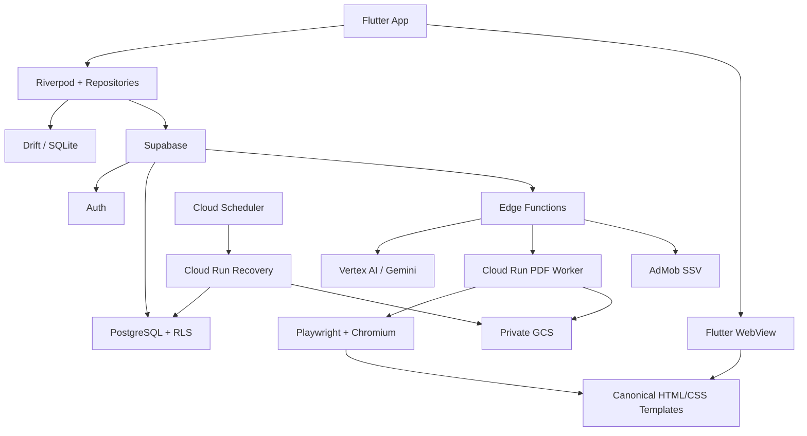
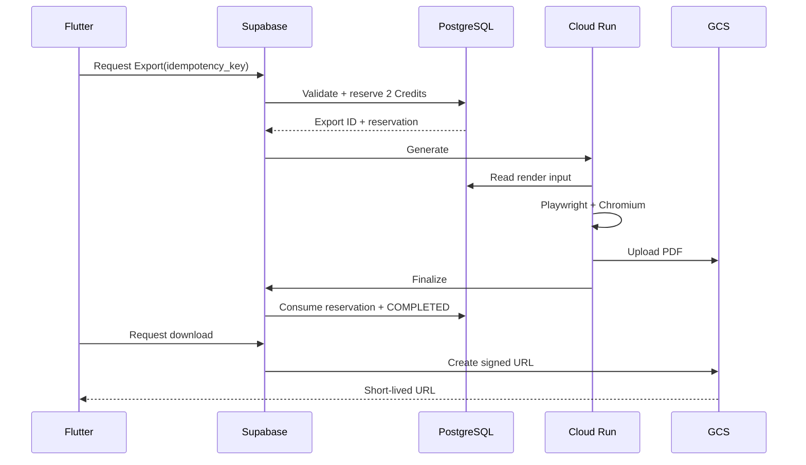

# JobiX — Architecture

**Version:** Official First Release  
**Status:** Ready  
**Scope:** MVP  
**Role:** Technical Architecture Source of Truth

> Product Design is authoritative for product behavior. This document defines the technical architecture required to implement it.

## 1. Architecture Principles

- Secure: Credits, rewards, exports, AI allowances, entitlements, and account ownership are server-authoritative.
- Cost-conscious: AI only on explicit actions; no unnecessary queues, microservices, realtime everywhere, or permanent PDF storage.
- Reliable: idempotency, transactional operations, retry-safe workflows, export recovery.
- Offline-capable where it matters: Profile editing and drafts.
- Maintainable: one canonical Resume representation.
- Arabic/English and RTL/LTR are first-class.
- No Kubernetes, Kafka, Redis, CRDT, or distributed microservice architecture in MVP unless measured need proves otherwise.

## 2. Final Stack

| Layer | Technology |
|---|---|
| Mobile | Flutter + Dart |
| State | Riverpod |
| Local DB | Drift + SQLite |
| Backend | Supabase |
| Database | PostgreSQL |
| Auth | Supabase Auth |
| Authorization | PostgreSQL RLS |
| Lightweight server logic | Supabase Edge Functions |
| Heavy workloads | Google Cloud Run |
| PDF | Playwright + Chromium |
| Storage | Private Google Cloud Storage |
| AI | Vertex AI / Gemini 3.8 Flash |
| Ads | Google AdMob Rewarded + official SSV |
| Recovery | Cloud Scheduler → Cloud Run |
| Resume source | Canonical HTML/CSS |
| Preview | Flutter WebView |

## 3. System Diagram



## 4. Authority Boundaries

### Client
The client owns the local working experience:
- Profile editing state
- local drafts
- unsynced edits
- local reference data
- UI state
- selected Resume language/template

### Server
The server is authoritative for:
- authenticated identity
- persisted Profile state
- Profile slot entitlements
- Credits and reservations
- AI allowances and usage
- Daily Reward
- Export state/history
- PDF object paths
- account deletion
- app policy/version

The client can never grant itself Credits, AI generations, rewards, or Profile slots.

## 5. PostgreSQL Logical Model

```text
auth.users
  └── users
       ├── application_personal_data
       ├── credit_transactions
       ├── credit_reservations
       ├── ai_entitlements / ai_usage
       ├── daily_rewards
       ├── profile_slots
       └── career_profiles
             ├── profile_personal_data
             ├── summaries
             ├── experiences
             ├── education
             ├── projects
             ├── skills
             ├── languages
             ├── optional_sections
             └── ai_generations

career_profiles
  └── resume_configurations
        └── exports
```

Core tables must include ownership, timestamps, ordering where relevant, and server version metadata.

### Application Personal Data
Reusable data for:
- new Profile creation
- Cover Letter
- Professional Email
- future career tools

### Profile Personal Data
Independent snapshot belonging to one Career Profile.

Changing application-level Personal Data must not silently mutate existing Profiles.

## 6. Career Profile and Resume

Career Profile = professional dataset.

Resume = presentation configuration:

```text
Career Profile
+ CV language
+ template
+ section visibility/order
= Resume render model
```

Language/template are not Profile identity.

MVP supports three Profile slots:
- Slot 1: free
- Slot 2: 10 Credits once
- Slot 3: 20 Credits once

Purchased slots remain unlocked permanently even if their Profile is deleted.

## 7. Local Persistence

Use Drift + SQLite selectively.

Local:
- Career Profile working data
- Resume configuration
- drafts
- dirty/sync metadata
- outbox
- reference catalogs
- onboarding progress where needed

Not authoritative/local:
- Credits
- AI allowance
- Daily Reward
- generated PDFs
- export state

The previous review explicitly validated selective persistence rather than making every backend feature fully offline. fileciteturn12file3L325-L336

## 8. Sync

Sync on meaningful actions:
- Save
- Next
- Complete
- leaving a major editing flow
- app foreground
- network restoration

Never sync every keystroke.

Use version-based optimistic concurrency:

```text
client base_version == server version
    → accept mutation
    → increment server version

client base_version != server version
    → conflict
    → server version wins
    → preserve local conflicting snapshot
    → inform user
```

No CRDT or complex merge UI in MVP.

## 9. RLS / Security

All user-owned data uses PostgreSQL RLS.

Ownership must derive from the authenticated session, not a trusted client-supplied user ID.

Never ship:
- Supabase service-role key
- GCP credentials
- Vertex credentials

in Flutter.

Private GCS only; signed URLs are generated after ownership checks and are short-lived.

## 10. Credits

Use two distinct concepts:

### `credit_transactions`
Append-only immutable ledger.

Examples:
- Signup +5
- Export -2
- Professional Email -1
- Cover Letter new PDF -1
- Daily Reward +2
- Profile 2 -10
- Profile 3 -20

### `credit_reservations`
Temporary holds:

```text
PENDING
CONSUMED
RELEASED
EXPIRED
```

Reservations are not financial events.

Available balance is derived from finalized ledger state minus active reservations. A cached balance may exist for performance but is never client-authoritative.

Concurrent requests must be transaction-safe and must not double-spend Credits.

## 11. Export

### Rules
- New PDF Export: 2 Credits
- Existing valid PDF download: 0 Credits
- Failed Export: no permanent charge
- PDF retention: 7 days

### Flow



Export states:

```text
GENERATING → COMPLETED
           → FAILED
```

Client-generated idempotency keys prevent duplicate charges from retries/double taps.

## 12. Export Recovery

Do not put heavy GCS recovery logic in Edge Functions.

Use:

```text
Cloud Scheduler
    ↓
Cloud Run /recover-stuck-exports
    ↓
find stale GENERATING exports
    ↓
check GCS object
    ├── exists → finalize safely
    └── missing → fail + release reservation
```

Use idempotent database operations.

This separation was explicitly validated in the previous architecture reconciliation. fileciteturn12file5L541-L563

## 13. GCS

Private bucket:

```text
jobix-exports
```

Store object path in DB, not a permanent signed URL:

```text
exports/{export_id}.pdf
```

Generated files expire after 7 days. History metadata remains after file expiry and provides Export Again.

## 14. Preview / PDF Rendering

One canonical HTML/CSS template:

```text
Career Profile
   ↓
Resume Render Model
   ↓
HTML/CSS
   ├── Flutter WebView → Preview
   └── Playwright + Chromium → PDF
```

The same source must control:
- content
- order
- language
- RTL/LTR
- template
- section visibility

The previous architecture reconciliation selected this strategy; WebView/Chromium fidelity is an implementation validation requirement. fileciteturn12file1L97-L105

## 15. Rendering Validation

Before production:
- Arabic
- mixed Arabic/English
- RTL sections
- bullets
- dates
- URLs
- long names
- long descriptions
- multi-page CVs
- fonts
- page breaks
- clipping/overflow

Not acceptable:
- broken Arabic
- broken RTL
- missing fonts
- major layout collapse
- scrambled sections
- severe preview/PDF mismatch

Minor pagination, kerning, or antialiasing differences are acceptable.

## 16. AI Architecture

```text
Flutter
 ↓
AI API
 ↓
auth + policy + allowance check
 ↓
input/schema validation
 ↓
prompt construction
 ↓
Vertex AI / Gemini 3.8 Flash
 ↓
output validation
 ↓
generation persistence
 ↓
response
```

### First Profile
6 total generations across the entire first Profile-building journey.

One button press = one generation.

When Profile Completeness >= 50%, the first-profile allowance ends.

Unused first-profile generations do not stack.

Starting the next day:
- Free: 3/day/user
- Premium: 10/day/user

Daily allowance is shared across all Profiles.

## 17. AI Entitlement and Anti-Abuse

Allowance is server-controlled and configurable.

Do not issue a new first-profile grant because of:
- logout
- another account
- another Profile
- Profile deletion

Use anti-abuse signals appropriate to the product while accepting that account identity cannot be proven with absolute certainty without stronger identity mechanisms.

AI limits must be changeable server-side without a mobile release.

## 18. AI Idempotency / Failure

Each generation request uses an idempotency key.

Successful generation:
1. authorize
2. validate
3. execute AI
4. validate output
5. persist source + output
6. consume allowance

AI failure:
- preserve original
- do not consume generation
- safe retry

## 19. AI History

Each generation stores:
- user_id
- profile_id
- section/field
- source user input
- AI output
- sequence/metadata
- model/provider
- created_at

Original user content is never overwritten.

Copy Profile copies current accepted content only, not AI history, rejected proposals, unused proposals, or generation allowance.

## 20. Free vs Premium AI

### Free
`Analyze My CV`
- weaknesses
- general recommendations
- ATS-related issues
- improvement areas

### Premium
`Optimize My CV`
- current content
- proposed content
- reason
- Apply / Reject

Text fields: accepted proposal replaces current text.

Skills: suggestions are additive by default; removal is explicit.

No AI change is applied automatically.

## 21. AI Anti-Fabrication

Prompts and validators must enforce:
- no invented facts
- no invented metrics
- no invented tools
- no invented achievements
- no unsupported employment details

If information is missing, AI should ask for facts rather than fabricate them.

## 22. ATS Readiness

Hybrid pipeline:

```text
Profile
 ↓
deterministic checks
 +
content extraction
 ↓
AI evaluation where semantic judgment is needed
 ↓
dimension scores
 ↓
weighted final score
 ↓
recommendations
```

Weights:

| Dimension | Weight |
|---|---:|
| Structure & ATS Compatibility | 20% |
| Experience / Evidence Quality | 25% |
| Content Clarity & Professional Language | 15% |
| Skills Quality & Relevance | 15% |
| Summary & Career Positioning | 10% |
| Consistency & Data Quality | 10% |
| Contact / Basic Professional Information | 5% |

Do not punish Students, Fresh Graduates, or Career Changers merely for having fewer years of experience. Evaluate the quality of available evidence in context.

ATS Readiness never gates Export.

## 23. Export Authorization

Export is allowed when:

```text
core fields valid
AND meaningful Career Content exists
AND every included section is complete
AND Resume configuration is valid
AND Credits are available
```

Required core contact data:
- Full Name
- valid Email
- Phone

Target Role, Country, and City are optional.

Work Experience is not universally required; Education/Projects/Skills can provide meaningful content for students.

## 24. Daily Reward

Reward:

> +2 Credits

Eligibility is materialized at the first App Open of each Africa/Cairo calendar day.

```text
if no daily_reward(user, cairo_date):
    eligibility = finalized_balance < 9
    insert atomically
```

Use:

```text
UNIQUE(user_id, reward_date)
```

Eligibility is frozen for that day.

Claim flow:

```text
Rewarded Ad
 ↓
AdMob SSV
 ↓
official signature verification
 ↓
validate expected reward
 ↓
transaction_id idempotency
 ↓
grant +2
```

Signature verification must follow Google's current official SSV protocol exactly; do not invent query canonicalization. fileciteturn12file5L518-L537

## 25. App Version / Policy

Server may expose:
- minimum_supported_version
- recommended_version
- policy_version

If required:

```text
APP_UPDATE_REQUIRED
```

This is important because AI allowances and other policies can change server-side.

## 26. Settings / Account Deletion

Settings:
- Account
- Sign out
- Delete Account
- App Language
- Application Personal Data
- Export History
- Privacy Policy
- Terms of Service

Account deletion is server-side and must cover:
- Profiles
- Profile Personal Data
- Application Personal Data
- AI history
- Credits/rewards records
- export metadata
- private generated PDFs
- account/auth data

Deletion must be safe to retry.

## 27. Localization

App:
- Arabic
- English

```text
Arabic app → RTL
English app → LTR
```

CV direction is independent:

```text
Arabic App + English CV
English App + Arabic CV
```

MVP:
- English ATS-friendly template
- Arabic ATS-friendly template

## 28. Reference Data

Local reference catalogs may include:
- countries
- Egyptian governorates
- skills
- autocomplete data

Custom user values remain supported where Product Design allows them.

## 29. Observability

Measure:
- API latency
- AI success/failure
- token usage
- generation usage
- export duration
- export failures
- Chromium failures
- GCS failures
- sync conflicts
- credit reservation failures
- reward verification failures
- deletion failures

Never log full CV text, personal data, signed URLs, or secrets unnecessarily.

Use request/export/generation IDs for tracing.

## 30. Cost Controls

Main variable costs:
1. AI
2. PDF generation
3. storage/egress

Controls:
- deterministic checks before AI
- explicit AI actions only
- configurable AI limits
- server rate limits
- 7-day PDF retention
- export idempotency
- WebView preview without generating PDF

The prior review identified AI as the dominant scale-sensitive cost and recommended configurable limits/rate controls. fileciteturn12file4L426-L448

## 31. Failure Modes

### Offline
- edit Profile locally
- queue sync
- AI unavailable
- Export unavailable

### AI failure
- original preserved
- no unfair generation consumption

### Export worker failure
- remain/recover `GENERATING`
- Scheduler → Cloud Run recovery

### GCS failure
- fail export
- release reservation

### App killed during export
- server operation continues
- user can later retrieve status

### Duplicate request
- idempotency key returns existing operation

### Sync conflict
- server version wins
- local conflicting snapshot preserved

## 32. Environments

At minimum:

```text
local
staging
production
```

Separate:
- Supabase project
- database
- GCS bucket
- Cloud Run service
- secrets
- AI configuration
- AdMob configuration

Never test production credit/reward behavior with production users.

## 33. CI/CD

```text
GitHub
 ↓
Pull Request
 ↓
tests
 ↓
CodeRabbit
 ↓
review
 ↓
merge
 ↓
staging
 ↓
smoke tests
 ↓
production
```

Architecture/security/database migrations require explicit review.

## 34. Database Migration Rules

All schema changes are migrations.

Prefer:

```text
additive schema
 ↓
compatible deployment
 ↓
backfill
 ↓
switch reads/writes
 ↓
remove old field later
```

Never ship a destructive migration that breaks an older supported mobile version unexpectedly.

## 35. Testing Strategy

### Unit
- validation
- completeness
- ATS deterministic checks
- credit math
- reservation lifecycle
- AI allowance
- Profile slot entitlement
- reward eligibility

### Integration
- RLS
- ownership
- credit concurrency
- idempotency
- export finalization/release
- reward claim idempotency
- deletion

### E2E
- onboarding → auth → Profile
- offline draft → sync
- AI → accept/reject
- Arabic/English CV
- preview
- export/download
- expired export → Export Again
- Profile 2/3
- Daily Reward
- Settings/account deletion

## 36. AI Quality Benchmark

Before production prompts are locked, test:
- Student
- Fresh Graduate
- Career Changer
- Early Career
- Experienced
- Arabic
- English
- mixed language
- weak/strong descriptions
- missing metrics

Measure:
- factual preservation
- hallucination rate
- clarity
- professional quality
- Arabic quality
- usefulness of ATS recommendations

## 37. Implementation Strategy

Build vertical slices, not the entire product in one pass.

1. Foundation: Flutter, Supabase, Auth, Drift, Riverpod, localization, RLS.
2. Onboarding/Auth/Profile creation/Personal Data/local persistence/sync.
3. Career Builder/sections/validation/hints/completeness/Profile switching.
4. HTML/CSS templates/WebView/Arabic-English rendering validation.
5. Credits/ledger/reservations/Profile slots.
6. Cloud Run PDF/GCS/export/recovery/history.
7. AI gateway/6 generations/daily allowance/history/Free vs Premium.
8. ATS engine/score/recommendations.
9. AdMob Rewarded/SSV/Daily Reward.
10. Settings/privacy/terms/deletion/version policy/security hardening.

## 38. Explicitly Out of Scope

- Kubernetes
- feature-per-service microservices
- Kafka/PubSub for normal CRUD
- Redis without measured need
- CRDT
- realtime synchronization everywhere
- AI on keystrokes
- client-side credit authority
- client-side reward grants
- separate preview/PDF template implementations
- permanent PDF storage

## 39. Future-Compatible Areas

Architecture can later support:
- subscriptions using entitlement-based modeling
- more Resume templates
- more CV languages
- tailored CV versions
- Cover Letter
- Professional Email
- job matching
- richer ATS analysis
- additional document types

Do not implement these as MVP architecture complexity unless required.

## 40. Final Architecture Decision

```text
Flutter + Riverpod + Drift/SQLite
          ↓
Supabase Auth + PostgreSQL + RLS + Edge Functions
          ↓
Cloud Run
  ├── Playwright + Chromium
  └── export recovery
          ↓
Private GCS

Vertex AI / Gemini 3.8 Flash
AdMob Rewarded + official SSV

Canonical HTML/CSS
  ├── Flutter WebView preview
  └── Chromium PDF

Credits
  ├── immutable ledger
  └── reservations

Sync
  ├── selective local persistence
  └── version-based optimistic concurrency
```

This is the official JobiX MVP technical architecture and the source of truth for implementation.

**Status: READY**
