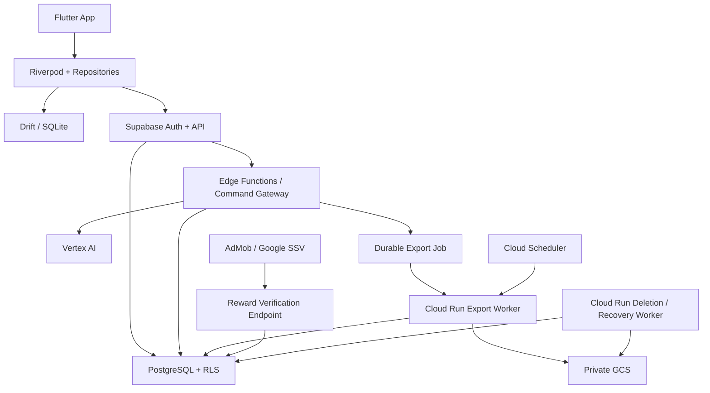

# JobiX — Architecture V2

**Version:** 2.0  
**Date:** September 19, 2026  
**Status:** Implementation-ready review draft; becomes the technical source of truth after approval  
**Scope:** MVP  
**Role:** Technical architecture and implementation specification

> This document consolidates the JobiX Constitution, Product Design, existing Architecture, the ten resolved architecture decisions, the six additional decisions, and the subsequent implementation requirements. It does not silently change product behavior. Where a behavior remains genuinely unspecified, it is listed under **Remaining Decisions Before Implementation**.

## 1. Authority, precedence, and normative language

During this review, use the following order:

1. JobiX Constitution
2. JobiX Product Design
3. Existing JobiX Architecture
4. The ten resolved architecture decisions
5. The six additional architecture decisions
6. Architecture review findings

The sixteen resolved decisions are incorporated here and must not remain a competing source of truth. After approval, this document and the updated Constitution become the active sources. A direct contradiction discovered during implementation must be recorded and escalated; implementation must not choose silently.

The words **MUST**, **MUST NOT**, **SHOULD**, and **MAY** are normative.

## 2. MVP scope and fixed product rules

MVP includes:

- Flutter mobile app with Riverpod and Drift/SQLite.
- Supabase Auth, PostgreSQL, RLS, and Edge Functions for application commands.
- Cloud Run for heavy work and recovery.
- Playwright + Chromium PDF generation and private GCS storage.
- Vertex AI for explicit AI actions.
- AdMob Rewarded with official Google Server-Side Verification.
- Three Career Profile slots.
- Profile editing, local drafts, Profile-level optimistic synchronization, Resume preview, and PDF history.
- English and Arabic Resume presentation. Changing CV language changes presentation and direction; it does not translate user-entered content.
- Professional Email as an MVP service: one explicit AI generation and 1 Credit per successful use.
- Cover Letter as an MVP service: one AI generation for each explicit draft and 1 Credit for each new PDF export; valid existing downloads are free.
- ATS Readiness as a separate profile-level assessment. It is not an ordinary AI-generation allowance operation and never blocks Export solely because of score.
- Premium-ready entitlement checks, but no Premium billing provider, purchase flow, trial, renewal, restore, or billing UI in MVP.

| Operation | Rule |
|---|---:|
| Signup | +5 Credits |
| New Resume PDF export | -2 Credits |
| New Cover Letter PDF export | -1 Credit |
| Professional Email successful use | -1 Credit |
| Profile 2 unlock | -10 Credits once |
| Profile 3 unlock | -20 Credits once |
| Verified Daily Reward | +2 Credits |
| Existing valid PDF download | 0 Credits |

AI allowance:

- First Profile-building phase: 6 total explicit AI generations across the entire first Career Profile journey.
- When Profile Completeness reaches 50% or higher, the first phase ends permanently; unused units do not stack.
- Starting the next Cairo calendar day: Free 3 generations per user per day.
- Premium 10/day exists only when a future valid server entitlement exists.
- ATS evaluation is separate from this allowance.

## 3. Architecture principles and non-goals

1. Credits, rewards, AI allowance, Profile slots, exports, and account ownership are server-authoritative.
2. User-provided career information is the source of truth. AI output is a proposal until accepted.
3. Every retryable command with a harmful or billable side effect is idempotent.
4. Profile editing works offline where practical; Credits, Rewards, AI allowance, entitlements, and server export state never become local authority.
5. One canonical Resume render model feeds both WebView preview and Chromium PDF.
6. Arabic, English, mixed-language content, RTL, and LTR are first-class.
7. MVP does not introduce Kubernetes, Kafka/Pub/Sub, Redis, CRDTs, or feature-per-service microservices without measured need and architecture review.
8. Durable database job state is sufficient for MVP export dispatch and recovery; a general-purpose queue is not required.
9. Sensitive text is untrusted input and must not appear in ordinary logs.

## 4. System topology and boundaries



### Flutter

Flutter owns UI state, local editing state, drafts, unsynced changes, local reference data, Resume selection before synchronization, and local conflict snapshots. It sends authenticated commands and displays authoritative server results. It MUST NOT grant Credits, Rewards, AI generations, Profile slots, or successful exports.

### Supabase Auth

Supabase Auth owns sign-up, sign-in, session refresh, password recovery, and authenticated identity. A database trigger or idempotent bootstrap command creates the application `users` row after first authenticated use.

### PostgreSQL and RLS

PostgreSQL is the source of truth for application data and transactional business rules. RLS protects user-owned rows. Credit, allowance, slot, reward, deletion, and export mutations run through narrow server commands or transactional database functions rather than client-written table updates.

### Edge Functions

Edge Functions verify the user JWT, validate command envelopes, enforce rate limits and policy/version checks, call transactional RPCs, invoke lightweight AI gateway logic, and create durable export jobs. They MUST NOT perform heavy PDF generation or privileged GCS processing.

### Cloud Run

Cloud Run processes durable export jobs, recovery, GCS operations, and deletion work that cannot safely complete inside one request. Calls from Edge Functions, Scheduler, and internal workers use authenticated service identities and request IDs. Workers claim jobs with leases and fencing tokens.

### GCS

GCS stores private generated PDFs only. Objects are addressed by opaque IDs, not names, email addresses, or CV text. The database stores object paths and hashes; it never stores permanent signed URLs.

### Vertex AI

Vertex AI is called only through server-side code. The model ID, prompt/template version, input/output limits, and provider configuration are server-managed. The mobile client never receives provider credentials.

### AdMob / Google SSV

AdMob sends an authenticated server-to-server verification callback to the reward endpoint. The client cannot grant the reward and cannot be the authority for callback validity.

## 5. Cross-cutting data and API conventions

### Identifiers and time

- Primary identifiers are UUIDs unless stated otherwise.
- Server timestamps are UTC `timestamptz`.
- Daily Reward dates are derived on the server using `Africa/Cairo` and stored as `date`.
- Client timestamps are informational only and never decide conflicts or financial state.
- Credit values are integer Credits; no floating-point arithmetic is used.
- User text limits are enforced server-side after Unicode normalization.

### Command envelope

All mutating commands use this shape:

```json
{
  "request_id": "uuid",
  "idempotency_key": "uuid",
  "expected_profile_version": 42,
  "payload": {}
}
```

`request_id` identifies one transport attempt. `idempotency_key` identifies one logical user action and MUST remain unchanged across retries. `expected_profile_version` is required for Profile mutations and proposal application. Queries do not require an idempotency key.

### Response envelope

```json
{
  "request_id": "uuid",
  "operation_id": "uuid",
  "state": "SUCCEEDED",
  "data": {},
  "authoritative_version": 43,
  "error": null
}
```

An operation that is still running returns `PROCESSING`, `QUEUED`, or `UNKNOWN` with an operation ID that can be queried using the same logical operation. A replay with the same idempotency key returns the original operation/result.

### Error taxonomy

The API uses stable machine-readable codes and localized client messages:

- `AUTH_REQUIRED`, `FORBIDDEN`, `NOT_FOUND`, `ACCOUNT_DELETING`
- `VALIDATION_FAILED`, `INVALID_STATE`, `APP_UPDATE_REQUIRED`
- `VERSION_CONFLICT`, `STALE_PROPOSAL`, `RESOURCE_DELETED`
- `IDEMPOTENCY_KEY_REUSE`, `OPERATION_PROCESSING`, `OPERATION_UNKNOWN`
- `CREDIT_INSUFFICIENT`, `RESERVATION_EXPIRED`, `CREDIT_OPERATION_FAILED`
- `QUOTA_EXHAUSTED`, `PREMIUM_REQUIRED`, `AI_INPUT_INVALID`, `AI_OUTPUT_INVALID`
- `EXPORT_NOT_READY`, `EXPORT_EXPIRED`, `EXPORT_OBJECT_MISSING`
- `REWARD_NOT_ELIGIBLE`, `REWARD_PENDING`, `SSV_INVALID`, `SSV_REPLAY`
- `RATE_LIMITED`, `SERVICE_UNAVAILABLE`, `RETRYABLE_INTERNAL_ERROR`

### Pagination

History and transaction queries use opaque cursor pagination:

```json
{ "limit": 25, "cursor": "opaque-string" }
```

The server caps `limit` at 100 and returns `next_cursor`. No client may construct a cursor from timestamps.

## 6. API / RPC contract

Commands are exposed through a small Edge Function/secure RPC surface. The names below are logical operation names; transport naming may be finalized without changing their contracts.

### Common authorization rules

Every operation verifies the JWT subject and derives `user_id` from the session. A client-supplied `user_id` is ignored or rejected. Profile IDs, export IDs, generation IDs, and slot numbers are checked for ownership inside the same transaction that mutates them. Internal worker operations require service identity and never accept user identity as authority.

### Public operation catalog

| Operation | Auth | Idempotent | Main payload | Result |
|---|---|---:|---|---|
| `app.bootstrap` | user | no | app version, locale | user, policy, profiles, balance summary |
| `onboarding.save` | user | yes | four answers | saved context and version |
| `profile.list` | user | no | cursor | owned Profiles and slot state |
| `profile.get` | user | no | `profile_id` | Profile, sections, config, versions |
| `profile.create` | user | yes | name, optional copy source | new Profile and config |
| `profile.copy` | user | yes | source Profile, name | independent copied Profile |
| `profile.rename` | user | yes | Profile, name | updated Profile |
| `profile.delete` | user | yes | Profile | deletion result; entitlement retained |
| `profile.mutate` | user | yes | section operation + expected version | new Profile version and authoritative section |
| `profile.slot.list` | user | no | none | slot entitlements |
| `profile.slot.unlock` | user | yes | slot number | entitlement and Credit result |
| `ai.generate` | user | yes | operation type, Profile/content input | AI operation/generation/proposal |
| `ai.operation.get` | user | no | operation ID or key | authoritative AI state/result |
| `ats.evaluate` | user | yes | Profile/config version | ATS assessment or processing state |
| `professional_email.generate` | user | yes | email context/input | editable email output and Credit result |
| `cover_letter.generate` | user | yes | Profile/job context/input | draft candidate; no Credit charge |
| `credit.balance` | user | no | none | finalized/reserved/available values |
| `credit.transactions` | user | no | cursor/filter | paginated ledger entries |
| `daily_reward.open` | user | yes | client app-open ID | Cairo-date eligibility |
| `daily_reward.status` | user | no | Cairo date | eligibility/claim state |
| `daily_reward.claim` | user | yes | reward-date, ad context | pending/claimed state |
| `export.create` | user | yes | Profile/config or Cover Letter draft | durable export job |
| `export.status` | user | no | export ID | job state and metadata |
| `export.download` | user | no | export ID | short-lived signed URL if valid |
| `export.again` | user | yes | historical export ID | new export job from current data |
| `account.delete.request` | user | yes | confirmation token | deletion state |
| `account.delete.status` | user | no | deletion ID | deletion progress/result |

### Internal operations

The following are server-only and are not callable by Flutter:

- `credit.reserve`, `credit.consume`, `credit.release`.
- `export.claim`, `export.heartbeat`, `export.finalize`, `export.recover`.
- `ai.reconcile_unknown`, `ai.finalize`, `ai.release`.
- `deletion.step`, `deletion.verify`.
- `reward.verify_ssv`.

### `profile.mutate` section contract

`profile.mutate` is the single Profile write command for MVP. It supports typed operations for:

- `personal_information`
- `summary`
- `experience`
- `education`
- `projects`
- `skills`
- `languages`
- `certifications`
- `achievements`
- other approved optional sections
- `resume_configuration`

Example:

```json
{
  "profile_id": "uuid",
  "expected_profile_version": 42,
  "mutation": {
    "type": "upsert_item",
    "section": "experience",
    "item_id": null,
    "value": {
      "job_title": "Software Engineer",
      "company": "Example Co",
      "description": "..."
    }
  }
}
```

The server validates section-specific fields, date ranges, ordering, URLs, phone/email format, hard length limits, and whether an included optional section is complete enough to render. Every accepted mutation increments `career_profiles.profile_version` once and returns the authoritative state.

### Profile CRUD and slots

- `profile.create` creates the first free slot or an already-unlocked slot in one transaction, initializes all required child/config rows, and supports optional prefill from `application_personal_data`.
- `profile.copy` copies accepted current content only. It does not copy AI history, rejected proposals, unused allowance, or generation history.
- `profile.delete` is a soft lifecycle transition followed by transactional child cleanup; it never revokes a purchased slot.
- `profile.slot.unlock` locks `credit_accounts` and `profile_slots`, verifies the slot number and one-time entitlement, reserves/consumes the required Credits, and is safe against concurrent unlock requests.

### AI and ATS contracts

`ai.generate` accepts an approved operation type and source snapshot. It returns an `ai_operation_id`, state, allowance bucket, and—when successful—an `ai_generation_id` containing source and proposal. `Optimize My CV` returns `PREMIUM_REQUIRED` unless a valid Premium entitlement exists.

`ats.evaluate` is explicit and idempotent by `(user_id, profile_id, profile_version, resume_config_version, rubric_version)`. It may call AI internally but never reserves ordinary generation allowance. Repeating the same evaluation returns the existing assessment.

### Credit and reward contracts

`credit.balance` reports finalized, reserved, and available values from the server. `credit.transactions` is read-only and paginated. Client code cannot call `credit.reserve` directly.

`daily_reward.open` atomically materializes one row for the current Cairo date. `daily_reward.claim` records a pending claim and returns `REWARD_PENDING`; the verified AdMob SSV callback completes the grant. The client polls `daily_reward.status` and never treats ad completion alone as a grant.

### Export contracts

`export.create` validates the current Profile/draft, creates an immutable snapshot, reserves the service-specific Credits, and inserts a durable job in one transaction. It returns `QUEUED` even if worker dispatch is unavailable. A best-effort worker wake-up MAY occur after commit; Scheduler recovery is authoritative.

`export.download` checks ownership, `COMPLETED` state, `expires_at`, and object existence before issuing a short-lived signed URL. `export.again` never reuses the old snapshot; it reads the current Profile/configuration and creates a new charged job.

### Account deletion contracts

`account.delete.request` requires an authenticated session and explicit confirmation. It freezes new mutations, creates an idempotent deletion request, and returns progress. The client must wipe local account data after the server confirms deletion or when instructed by the deletion state. `account.delete.status` exposes only the caller's deletion state.

### Validation and initial rate limits

These are configurable operational defaults, not additional product rules:

| Operation family | Initial limit |
|---|---:|
| Profile mutations | 120/user/minute |
| AI generation requests | 10/user/minute, plus allowance |
| ATS evaluation | 6/user/hour |
| Export creation | 5/user/10 minutes |
| Reward claim/open | 3/user/day |
| History/transaction reads | 120/user/minute |

A rate-limit response is `RATE_LIMITED` with a retry-after value. The server never asks the client to use a new idempotency key for a retry of the same logical action.

## 7. PostgreSQL schema

### Common schema rules

- All tables use `public` unless a deployment-specific schema is documented.
- All user-owned rows have `user_id` directly or through a Profile foreign key.
- All mutable rows have `created_at`, `updated_at`; timestamps are server-generated.
- Hard deletes are used for account deletion and child rows; normal Profile item deletes are transactional and increment the Profile version.
- JSONB is limited to immutable snapshots, ordered configuration, provider metadata, and versioned recommendation payloads—not the primary editable Profile model.
- Foreign keys use `ON DELETE CASCADE` for account-owned data and `ON DELETE RESTRICT` where a worker must explicitly transition state first.

### Enumerations

```text
profile_status: ACTIVE, DELETING, DELETED
section_type: PERSONAL, SUMMARY, EXPERIENCE, EDUCATION, PROJECTS, SKILLS, LANGUAGES, CERTIFICATIONS, ACHIEVEMENTS, OTHER
entitlement_tier: FREE, PREMIUM
ai_operation_type: IMPROVE_SUMMARY, IMPROVE_EXPERIENCE, IMPROVE_PROJECT, SUGGEST_SKILLS, OPTIMIZE_CV, TRANSLATE_CONTENT, PROFESSIONAL_EMAIL, COVER_LETTER_DRAFT
ai_operation_state: REQUESTED, QUOTA_RESERVED, PROCESSING, VALIDATING, SUCCEEDED, FAILED, UNKNOWN, CANCELLED
ai_allowance_bucket: FIRST_PROFILE, DAILY, NONE
proposal_state: PROPOSED, ACCEPTED, REJECTED, SUPERSEDED
credit_reservation_state: PENDING, CONSUMED, RELEASED, EXPIRED
credit_reference_type: SIGNUP, RESUME_EXPORT, COVER_LETTER_EXPORT, PROFESSIONAL_EMAIL, PROFILE_SLOT, DAILY_REWARD, ADJUSTMENT
export_type: RESUME, COVER_LETTER
export_state: QUEUED, CLAIMED, GENERATING, UPLOADING, COMPLETED, RETRYABLE_FAILURE, FAILED, EXPIRED, MISSING_OBJECT, DELETION_PENDING, DELETED
reward_eligibility: ELIGIBLE, INELIGIBLE
reward_claim_state: UNCLAIMED, PENDING_VERIFICATION, CLAIMED, REJECTED, EXPIRED
sync_conflict_state: OPEN, SERVER_KEPT, LOCAL_REAPPLIED, DISCARDED, EXPIRED
```

### Account and context tables

#### `users`

Purpose: application account lifecycle and ownership root.

```text
id uuid PK REFERENCES auth.users(id) ON DELETE CASCADE
status text NOT NULL CHECK (status IN ('ACTIVE','DELETING','DELETED'))
created_at timestamptz NOT NULL DEFAULT now()
updated_at timestamptz NOT NULL DEFAULT now()
deleted_at timestamptz NULL
```

RLS permits the authenticated user to select only their own non-deleted row. Lifecycle mutations use server commands.

#### `onboarding_context`

Purpose: four lightweight research/preferences answers; never authoritative CV data.

```text
user_id uuid PK REFERENCES users(id) ON DELETE CASCADE
career_stage text NULL
career_goal text NULL
desired_work_location text NULL
help_areas jsonb NOT NULL DEFAULT '[]'
version bigint NOT NULL DEFAULT 1
created_at timestamptz NOT NULL DEFAULT now()
updated_at timestamptz NOT NULL DEFAULT now()
```

Checks restrict `help_areas` to an array of approved values plus future-compatible values. RLS is owner-only. Updates use optimistic versioning. Deleted with the account.

#### `application_personal_data`

Purpose: reusable personal data for new Profiles and future services.

```text
user_id uuid PK REFERENCES users(id) ON DELETE CASCADE
full_name text NULL
email text NULL
phone text NULL
country_code text NULL
city text NULL
linkedin_url text NULL
github_url text NULL
portfolio_url text NULL
version bigint NOT NULL DEFAULT 1
created_at timestamptz NOT NULL DEFAULT now()
updated_at timestamptz NOT NULL DEFAULT now()
```

Validation is server-side. Existing Profiles contain independent snapshots and are not silently changed.

#### `app_policies`

Purpose: server-controlled app and policy compatibility.

```text
policy_key text PK
minimum_supported_version text NOT NULL
recommended_version text NULL
policy_version text NOT NULL
configuration jsonb NOT NULL DEFAULT '{}'
updated_at timestamptz NOT NULL DEFAULT now()
```

Read-only to authenticated clients through a safe view/function; writes are deployment/admin-only.

### Profile tables

#### `profile_slots`

```text
id uuid PK
user_id uuid NOT NULL REFERENCES users(id) ON DELETE CASCADE
slot_number smallint NOT NULL CHECK (slot_number BETWEEN 1 AND 3)
unlocked boolean NOT NULL DEFAULT false
unlocked_at timestamptz NULL
unlock_transaction_id uuid NULL REFERENCES credit_transactions(id) ON DELETE SET NULL
created_at timestamptz NOT NULL DEFAULT now()
updated_at timestamptz NOT NULL DEFAULT now()
UNIQUE(user_id, slot_number)
```

Slot 1 is created unlocked at account bootstrap. Slots 2 and 3 are unlocked atomically with their Credit transaction. Deleting a Profile does not delete the slot row; account deletion does.

#### `career_profiles`

```text
id uuid PK
user_id uuid NOT NULL REFERENCES users(id) ON DELETE CASCADE
slot_number smallint NOT NULL CHECK (slot_number BETWEEN 1 AND 3)
name text NOT NULL
status profile_status NOT NULL DEFAULT ACTIVE
profile_version bigint NOT NULL DEFAULT 1
completeness_percent numeric(5,2) NOT NULL DEFAULT 0 CHECK (completeness_percent BETWEEN 0 AND 100)
completeness_algorithm_version text NOT NULL
first_profile_candidate boolean NOT NULL DEFAULT false
created_at timestamptz NOT NULL DEFAULT now()
updated_at timestamptz NOT NULL DEFAULT now()
deleted_at timestamptz NULL
PARTIAL UNIQUE INDEX uq_active_profile_slot ON career_profiles(user_id, slot_number) WHERE status <> 'DELETED'
INDEX(user_id, status, updated_at DESC)
```

Profile mutations lock this row, validate `expected_profile_version`, apply child changes, recompute completeness, increment `profile_version`, and possibly latch the first-profile AI transition.

#### Profile section tables

All section tables include `id uuid PK`, `profile_id uuid REFERENCES career_profiles(id) ON DELETE CASCADE`, `sort_order integer NOT NULL`, `created_at`, `updated_at`, and an optional `deleted_at` only when needed for local-sync reconciliation. Each has an index on `(profile_id, sort_order, updated_at)` and RLS through the parent Profile.

- `profile_personal_data`: full name, email, phone, country, city, LinkedIn, GitHub, portfolio.
- `profile_summaries`: one row per Profile, `text text`, `version bigint`.
- `profile_experiences`: job title, company, location, start date, end date, `is_current`, description.
- `profile_education`: degree, institution, field of study, start date, end date, `is_current`, description.
- `profile_projects`: project name, role, description, date, URL.
- `profile_skills`: skill name, normalized key, optional source, sort order.
- `profile_languages`: language name, proficiency, sort order.
- `profile_certifications`: name, issuer, date, URL, description.
- `profile_achievements`: title, issuer/context, date, description, URL.
- `profile_optional_sections`: section type, title, payload JSONB validated against a versioned schema; used only for approved optional sections.

Editable fields have explicit maximum lengths matching Product Design. URLs use an allowlist of schemes (`https` and approved web forms). The server rejects invalid dates and inconsistent `is_current`/end-date combinations.

#### `resume_configurations`

```text
id uuid PK
profile_id uuid UNIQUE NOT NULL REFERENCES career_profiles(id) ON DELETE CASCADE
cv_language text NOT NULL CHECK (cv_language IN ('en','ar'))
template_id text NOT NULL
template_version text NOT NULL
section_order jsonb NOT NULL
section_visibility jsonb NOT NULL
render_config_version text NOT NULL
version bigint NOT NULL DEFAULT 1
created_at timestamptz NOT NULL DEFAULT now()
updated_at timestamptz NOT NULL DEFAULT now()
```

Configuration changes use Profile-level optimistic concurrency and increment both configuration version and Profile version.

### Credits and entitlements

#### `credit_accounts`

```text
user_id uuid PK REFERENCES users(id) ON DELETE CASCADE
finalized_balance integer NOT NULL DEFAULT 0 CHECK (finalized_balance >= 0)
reserved_balance integer NOT NULL DEFAULT 0 CHECK (reserved_balance >= 0)
version bigint NOT NULL DEFAULT 1
updated_at timestamptz NOT NULL DEFAULT now()
```

This is a transactionally maintained server cache used for locking and fast reads. The ledger and reservations remain the audit/source records. Clients never perform authoritative arithmetic.

#### `credit_transactions`

```text
id uuid PK
user_id uuid NOT NULL REFERENCES users(id) ON DELETE CASCADE
delta integer NOT NULL CHECK (delta <> 0)
reference_type credit_reference_type NOT NULL
reference_id uuid NULL
idempotency_key uuid NULL
metadata jsonb NOT NULL DEFAULT '{}'
created_at timestamptz NOT NULL DEFAULT now()
PARTIAL UNIQUE INDEX uq_credit_reference_idempotency ON credit_transactions(user_id, reference_type, idempotency_key) WHERE idempotency_key IS NOT NULL
INDEX(user_id, created_at DESC)
```

Rows are append-only while the account exists. Corrections use compensating transactions. Account deletion removes them as an explicit lifecycle rule.

#### `credit_reservations`

```text
id uuid PK
user_id uuid NOT NULL REFERENCES users(id) ON DELETE CASCADE
operation_type text NOT NULL
idempotency_key uuid NOT NULL
amount integer NOT NULL CHECK (amount > 0)
state credit_reservation_state NOT NULL DEFAULT PENDING
resource_id uuid NULL
expires_at timestamptz NOT NULL
consumed_transaction_id uuid NULL REFERENCES credit_transactions(id) ON DELETE SET NULL
created_at timestamptz NOT NULL DEFAULT now()
updated_at timestamptz NOT NULL DEFAULT now()
UNIQUE(user_id, operation_type, idempotency_key)
INDEX(state, expires_at)
```

Reservation creation locks `credit_accounts`, verifies available balance, increments `reserved_balance`, and commits atomically. Consume moves the amount from reserved to finalized; release decrements reserved without a ledger entry.

#### `entitlements`

```text
id uuid PK
user_id uuid NOT NULL REFERENCES users(id) ON DELETE CASCADE
tier entitlement_tier NOT NULL DEFAULT FREE
source text NOT NULL DEFAULT 'system'
valid_from timestamptz NOT NULL DEFAULT now()
valid_until timestamptz NULL
status text NOT NULL CHECK (status IN ('ACTIVE','EXPIRED','REVOKED'))
metadata jsonb NOT NULL DEFAULT '{}'
created_at timestamptz NOT NULL DEFAULT now()
updated_at timestamptz NOT NULL DEFAULT now()
INDEX(user_id, status, valid_until)
```

MVP creates a Free entitlement. No billing provider writes Premium in MVP. RLS is owner-read; server-only writes.

### AI and ATS tables

#### `ai_allowance_accounts`

```text
user_id uuid PK REFERENCES users(id) ON DELETE CASCADE
first_profile_id uuid NULL REFERENCES career_profiles(id) ON DELETE SET NULL
first_total integer NOT NULL DEFAULT 6
first_reserved integer NOT NULL DEFAULT 0
first_consumed integer NOT NULL DEFAULT 0
first_phase_ended_at timestamptz NULL
first_phase_ended_cairo_date date NULL
daily_cairo_date date NULL
daily_limit integer NOT NULL DEFAULT 3
daily_reserved integer NOT NULL DEFAULT 0
daily_consumed integer NOT NULL DEFAULT 0
version bigint NOT NULL DEFAULT 1
updated_at timestamptz NOT NULL DEFAULT now()
CHECK (first_reserved >= 0 AND first_consumed >= 0 AND daily_reserved >= 0 AND daily_consumed >= 0)
```

The row is locked for every allowance reservation. When the first Profile crosses 50%, the server latches `first_phase_ended_at` and does not permit daily use until the next Cairo date.

#### `ai_operations`

```text
id uuid PK
user_id uuid NOT NULL REFERENCES users(id) ON DELETE CASCADE
operation_type ai_operation_type NOT NULL
idempotency_key uuid NOT NULL
payload_hash text NOT NULL
state ai_operation_state NOT NULL DEFAULT REQUESTED
allowance_bucket ai_allowance_bucket NOT NULL
allowance_units integer NOT NULL DEFAULT 1 CHECK (allowance_units = 1)
provider_request_id text NULL
provider_model text NULL
prompt_version text NULL
input_version bigint NULL
error_code text NULL
created_at timestamptz NOT NULL DEFAULT now()
updated_at timestamptz NOT NULL DEFAULT now()
completed_at timestamptz NULL
UNIQUE(user_id, operation_type, idempotency_key)
UNIQUE(provider_request_id) WHERE provider_request_id IS NOT NULL
INDEX(user_id, created_at DESC)
INDEX(state, updated_at)
```

A repeated key with a different payload hash returns `IDEMPOTENCY_KEY_REUSE`.

#### `ai_generations`

```text
id uuid PK
operation_id uuid UNIQUE NOT NULL REFERENCES ai_operations(id) ON DELETE CASCADE
user_id uuid NOT NULL REFERENCES users(id) ON DELETE CASCADE
profile_id uuid NULL REFERENCES career_profiles(id) ON DELETE SET NULL
section_type section_type NULL
source_input jsonb NOT NULL
proposal_output jsonb NOT NULL
base_profile_version bigint NULL
model_id text NOT NULL
model_version text NOT NULL
prompt_version text NOT NULL
proposal_state proposal_state NOT NULL DEFAULT PROPOSED
created_at timestamptz NOT NULL DEFAULT now()
updated_at timestamptz NOT NULL DEFAULT now()
```

Original source and proposal are never overwritten. Applying a proposal requires a current-version check or an explicit stale-proposal resolution command.

#### `ats_assessments`

```text
id uuid PK
user_id uuid NOT NULL REFERENCES users(id) ON DELETE CASCADE
profile_id uuid NOT NULL REFERENCES career_profiles(id) ON DELETE CASCADE
profile_version bigint NOT NULL
resume_config_version bigint NOT NULL
rubric_version text NOT NULL
model_version text NULL
prompt_version text NULL
score numeric(5,2) NULL CHECK (score BETWEEN 0 AND 100)
dimensions jsonb NOT NULL
recommendations jsonb NOT NULL
state text NOT NULL CHECK (state IN ('QUEUED','RUNNING','SUCCEEDED','FAILED','STALE','INSUFFICIENT_DATA'))
created_at timestamptz NOT NULL DEFAULT now()
completed_at timestamptz NULL
UNIQUE(profile_id, profile_version, resume_config_version, rubric_version)
INDEX(profile_id, created_at DESC)
```

ATS rows are owner-readable and server-written. The current Profile/configuration marks older assessments stale; it does not automatically invoke AI.

### Rewards

#### `daily_rewards`

```text
id uuid PK
user_id uuid NOT NULL REFERENCES users(id) ON DELETE CASCADE
reward_date date NOT NULL
eligibility reward_eligibility NOT NULL
eligibility_balance integer NOT NULL CHECK (eligibility_balance >= 0)
claim_state reward_claim_state NOT NULL DEFAULT UNCLAIMED
claim_idempotency_key uuid NULL
ad_transaction_id text NULL
ledger_transaction_id uuid NULL REFERENCES credit_transactions(id) ON DELETE SET NULL
created_at timestamptz NOT NULL DEFAULT now()
updated_at timestamptz NOT NULL DEFAULT now()
UNIQUE(user_id, reward_date)
UNIQUE(ad_transaction_id) WHERE ad_transaction_id IS NOT NULL
INDEX(user_id, reward_date DESC)
```

Eligibility is materialized only by the server at first App Open for the Cairo date. A verified callback changes `PENDING_VERIFICATION` to `CLAIMED` and writes exactly one +2 ledger transaction.

### Export and document tables

#### `export_snapshots`

```text
id uuid PK
user_id uuid NOT NULL REFERENCES users(id) ON DELETE CASCADE
export_type export_type NOT NULL
profile_id uuid NULL REFERENCES career_profiles(id) ON DELETE SET NULL
source_version bigint NULL
snapshot_schema_version text NOT NULL
snapshot_json jsonb NOT NULL
snapshot_sha256 text NOT NULL
created_at timestamptz NOT NULL DEFAULT now()
```

The snapshot contains the exact Profile/service content, Resume language, template/configuration, visibility/order, renderer/assets/fonts versions, and any Cover Letter draft used. It is immutable.

#### `export_jobs`

```text
id uuid PK
user_id uuid NOT NULL REFERENCES users(id) ON DELETE CASCADE
export_type export_type NOT NULL
profile_id uuid NULL REFERENCES career_profiles(id) ON DELETE SET NULL
snapshot_id uuid NOT NULL REFERENCES export_snapshots(id) ON DELETE RESTRICT
idempotency_key uuid NOT NULL
credit_reservation_id uuid NOT NULL REFERENCES credit_reservations(id) ON DELETE RESTRICT
state export_state NOT NULL DEFAULT QUEUED
attempt_count integer NOT NULL DEFAULT 0
worker_id text NULL
lease_token uuid NULL
lease_expires_at timestamptz NULL
next_attempt_at timestamptz NULL
object_path text NULL
object_generation text NULL
object_sha256 text NULL
page_count integer NULL
expires_at timestamptz NULL
error_code text NULL
error_detail_safe text NULL
created_at timestamptz NOT NULL DEFAULT now()
updated_at timestamptz NOT NULL DEFAULT now()
completed_at timestamptz NULL
UNIQUE(user_id, export_type, idempotency_key)
INDEX(state, next_attempt_at, lease_expires_at)
INDEX(user_id, created_at DESC)
```

#### `professional_emails`

```text
id uuid PK
user_id uuid NOT NULL REFERENCES users(id) ON DELETE CASCADE
operation_id uuid UNIQUE NOT NULL REFERENCES ai_operations(id) ON DELETE CASCADE
credit_reservation_id uuid NULL REFERENCES credit_reservations(id) ON DELETE SET NULL
credit_transaction_id uuid NULL REFERENCES credit_transactions(id) ON DELETE SET NULL
subject text NULL
body text NOT NULL
status text NOT NULL CHECK (status IN ('DRAFT','ACCEPTED','DELETED'))
created_at timestamptz NOT NULL DEFAULT now()
updated_at timestamptz NOT NULL DEFAULT now()
```

MVP treats Professional Email as editable text output; no PDF is created unless Product Design later adds that behavior.

#### `cover_letters`

```text
id uuid PK
user_id uuid NOT NULL REFERENCES users(id) ON DELETE CASCADE
profile_id uuid NULL REFERENCES career_profiles(id) ON DELETE SET NULL
operation_id uuid UNIQUE NOT NULL REFERENCES ai_operations(id) ON DELETE CASCADE
content text NOT NULL
status text NOT NULL CHECK (status IN ('DRAFT','ACCEPTED','DELETED'))
created_at timestamptz NOT NULL DEFAULT now()
updated_at timestamptz NOT NULL DEFAULT now()
```

Cover Letter PDF exports point to the accepted draft in their immutable snapshot.

### Operational and deletion tables

#### `idempotency_records`

```text
id uuid PK
user_id uuid NOT NULL REFERENCES users(id) ON DELETE CASCADE
operation_type text NOT NULL
idempotency_key uuid NOT NULL
payload_hash text NOT NULL
operation_id uuid NULL
response_state jsonb NOT NULL
created_at timestamptz NOT NULL DEFAULT now()
expires_at timestamptz NOT NULL
UNIQUE(user_id, operation_type, idempotency_key)
INDEX(expires_at)
```

Records are retained for at least 30 days for client-retry protection. Operation-specific rows such as `ai_operations`, `export_jobs`, and reservations remain while needed for recovery. A key reused with a different payload is rejected.

#### `deletion_requests`

```text
id uuid PK
user_id uuid UNIQUE NOT NULL REFERENCES users(id) ON DELETE CASCADE
state text NOT NULL CHECK (state IN ('REQUESTED','AUTHORIZED','FROZEN','DELETING','VERIFYING','RETRYABLE_FAILURE','COMPLETED','FAILED'))
confirmation_hash text NOT NULL
requested_at timestamptz NOT NULL DEFAULT now()
confirmed_at timestamptz NULL
started_at timestamptz NULL
completed_at timestamptz NULL
attempt_count integer NOT NULL DEFAULT 0
last_error_code text NULL
updated_at timestamptz NOT NULL DEFAULT now()
```

The row exists during the workflow and is removed with account data after successful completion. Minimal non-PII operational logs retain the deletion request ID and outcome according to the logging policy.

### RLS policy summary

- User-owned tables: `user_id = auth.uid()` for `SELECT`; client writes only through approved commands/RPCs.
- Profile child tables: access through a parent ownership `EXISTS` policy.
- Ledger, reservations, allowance, entitlements, rewards, exports, AI operations, and deletion rows: owner-readable; server-only writes.
- Snapshots and generated file metadata: owner-readable; server-only creation/finalization.
- Service-role/worker access uses dedicated server paths and is never exposed to clients.
- Admin/deployment policy tables are not user-writable.

Representative owner policy:

```sql
CREATE POLICY own_rows_select ON public.some_user_table
  FOR SELECT USING (user_id = auth.uid());

CREATE POLICY own_rows_update ON public.some_user_table
  FOR UPDATE USING (user_id = auth.uid())
  WITH CHECK (user_id = auth.uid());
```

Client inserts/deletes for financial-like, reward, entitlement, export, AI, and deletion tables are denied; approved server commands use tightly scoped transactional functions. Profile child policies use an ownership EXISTS check through career_profiles.

## 8. State machines

### AI Generation

```text
REQUESTED
  → QUOTA_RESERVED
  → PROCESSING
  → VALIDATING
  → SUCCEEDED
  → FAILED
  → UNKNOWN
  → CANCELLED
```

Rules:

- `REQUESTED → QUOTA_RESERVED`: transactional allowance row lock and unique idempotency insert.
- `QUOTA_RESERVED → PROCESSING`: server starts one provider request and stores provider request ID when available.
- `PROCESSING → VALIDATING`: provider returns output.
- `VALIDATING → SUCCEEDED`: schema and anti-fabrication checks pass; generation is persisted; allowance is consumed.
- `VALIDATING → FAILED`: invalid output; allowance is released; no generation is returned.
- Provider timeout with a known definitive failure: `FAILED` and release.
- Provider timeout with unknown outcome: `UNKNOWN`; hold the allowance reservation and reconcile using the same operation ID/key. Do not start a new logical generation.
- Client timeout does not change server state. The client queries with the same key.
- `UNKNOWN → SUCCEEDED` if a valid provider result is recovered; `UNKNOWN → FAILED` after bounded reconciliation proves no valid result, releasing the allowance.
- `SUCCEEDED` is terminal for the operation. Applying/rejecting the proposal is a separate idempotent mutation.
- Invalid transitions return `INVALID_STATE` and do not mutate counters.

### Credit reservation

```text
PENDING → CONSUMED
PENDING → RELEASED
PENDING → EXPIRED → RELEASED
```

Only the owning server operation may consume or release a reservation. A reaper expires stale pending reservations. A late worker with a stale lease cannot consume an expired reservation. All transitions lock `credit_accounts` and the reservation row in one transaction.

### Resume/Cover Letter export

```text
QUEUED → CLAIMED → GENERATING → UPLOADING → COMPLETED
   │         │          │             │
   │         │          ├→ RETRYABLE_FAILURE → QUEUED
   │         └→ RETRYABLE_FAILURE → QUEUED
   └→ FAILED / CANCELLED
COMPLETED → EXPIRED
COMPLETED → MISSING_OBJECT
Any active state → DELETION_PENDING → DELETED
```

- Job creation, snapshot, and Credit reservation commit together.
- A worker claims with `SELECT ... FOR UPDATE SKIP LOCKED`, writes `worker_id`, random `lease_token`, `lease_expires_at`, and increments `attempt_count`.
- Heartbeats extend the lease only when the lease token matches.
- A worker may finalize only with the current lease token. Duplicate workers or late workers receive a no-op/stale result.
- Worker timeout or lease expiry moves the job to `RETRYABLE_FAILURE`; recovery requeues it until the maximum attempt count, then releases Credits and marks `FAILED`.
- PDF failure and GCS upload failure are retryable within the limit. After the limit, the reservation is released.
- After upload, the worker verifies object existence, size, content type, and hash before consuming Credits and marking `COMPLETED`.
- A missing object for a completed job marks `MISSING_OBJECT`; download is denied and a new charged Export Again is required.
- A lifecycle expiry marks the job `EXPIRED`; history remains.
- Export Again creates a new snapshot/job from current content and uses the service charge.

MVP operational defaults: 5-minute worker lease, 60-second heartbeat, 10-minute render timeout, maximum 3 attempts, recovery scan every minute. These are configuration values, not user-facing product rules.

### Daily Reward

```text
UNMATERIALIZED → ELIGIBLE
UNMATERIALIZED → INELIGIBLE
ELIGIBLE → PENDING_VERIFICATION
PENDING_VERIFICATION → CLAIMED
PENDING_VERIFICATION → REJECTED
```

`daily_reward.open` creates exactly one row for `(user_id, cairo_date)` using finalized balance before reservations. A verified AdMob SSV callback with a unique transaction ID changes the state to `CLAIMED` and inserts +2 Credits. Duplicate callbacks are harmless. Offline opens cannot materialize or claim authoritative rewards.

### Account deletion

```text
REQUESTED → AUTHORIZED → FROZEN → DELETING → VERIFYING → COMPLETED
                                      └→ RETRYABLE_FAILURE → DELETING
```

`FROZEN` rejects new Profile, AI, Credit, Reward, and Export commands. Workers check deletion state before starting and before finalizing. After verification, active application data and private GCS files are inaccessible. Provider backups follow their retention lifecycle.

### Profile synchronization and conflict

```text
LOCAL_CLEAN → LOCAL_DIRTY → OUTBOX_PENDING → SYNCING
SYNCING → LOCAL_CLEAN
SYNCING → CONFLICT
CONFLICT → SERVER_KEPT | LOCAL_REAPPLIED | DISCARDED | EXPIRED
```

The server compares `expected_profile_version`. A mismatch rejects the mutation, returns the authoritative server snapshot/version, and preserves the local snapshot. Reapplying local changes creates a new mutation against the current server version; it is not a blind overwrite.

## 9. Security and IAM model

| Component | Authenticates with | May access/mutate | Must never trust |
|---|---|---|---|
| Flutter | Supabase user JWT; public anon key only | Own authorized commands/queries | client user ID, Credits, reward result, signed URLs, AI count |
| Supabase Auth | managed provider | identity/session | client claims beyond verified JWT |
| PostgreSQL/RLS | `auth.uid()` for user paths | own rows; server functions for controlled mutations | arbitrary user IDs in payloads |
| Edge Functions | verified JWT; server secrets in Secret Manager | validate and invoke scoped RPCs | client ownership or client-calculated balances |
| Cloud Run worker | OIDC service identity plus server-side DB/storage credential | claimed jobs, snapshots, private GCS, scoped finalization | client-supplied job ownership or stale lease |
| GCS | Cloud Run service account | private objects under app prefix | public access, user filenames |
| Vertex AI | Cloud Run/Edge server identity | submitted AI payloads under provider policy | raw client prompts without validation |
| AdMob SSV endpoint | HTTPS plus official Google signature verification | reward verification state | client ad-completion claims |
| Cloud Scheduler | signed service identity | invoke recovery/deletion endpoints | unauthenticated triggers |

### Secrets and credentials

- Supabase service-role or database credentials, if required by a worker, live only in Secret Manager and never in Flutter.
- Cloud Run uses separate service accounts for export, recovery, and deletion where practical.
- GCS bucket access is least-privilege object access; no public bucket or object ACLs.
- Vertex credentials are server-only.
- Secrets are rotated through deployment configuration; logs never print values.

### RLS and privileged workers

All client data access is RLS-protected. A worker may use a dedicated restricted database role or a narrowly scoped server function. If a Supabase service-role credential is necessary for a deployment limitation, it is held only by Cloud Run/Edge Functions, restricted by code review, and used only with job ownership and state checks. It is never exposed to clients.

### GCS and signed URLs

Objects are private. `export.download` performs an ownership and state check, then creates a signed URL with a short lifetime (for example, 10 minutes). URLs are not stored in the database, logs, analytics, or client persistent storage.

### Input and rendering security

User text, URLs, HTML fragments, AI output, and imported data are untrusted. The server escapes text, sanitizes URLs, rejects unsafe schemes, uses an allowlist of local assets/fonts, and disables uncontrolled external resource loading in WebView/Chromium documents.

### Logging and PII

Use request, operation, export, generation, reward, and deletion IDs for tracing. Do not log full CV text, personal contact data, prompts/outputs by default, signed URLs, secrets, raw SSV query strings, or provider credentials. Error metadata is redacted and size-limited.

## 10. Local Drift/SQLite and synchronization

### Local tables

The client stores only what supports offline editing and safe recovery:

- `local_profiles` and normalized local section tables mirroring editable Profile data.
- `local_resume_configurations`.
- `local_drafts` for unsaved field/section work.
- `local_outbox` with mutation ID, Profile ID, expected version, payload, attempt count, next retry time, and state.
- `local_conflict_snapshots` with server snapshot, local snapshot, server version, local base version, state, and created/expiry timestamps.
- `local_reference_catalogs` with catalog version and expiry.
- `local_onboarding_progress` before authentication; it is merged into server `onboarding_context` after authentication.

### Never local authority

Do not treat local values as authoritative for Credits, AI allowance, Premium, Rewards, Profile slot entitlements, export state, or account deletion. Generated PDFs are not persisted as an authority; the client may hold a temporary download according to platform behavior.

### Persistence and outbox

Meaningful editing actions write the local database before navigation. `Save`, `Next`, `Complete`, app foreground, and network restoration enqueue or flush mutations. Keystrokes are not individually synchronized.

Each outbox mutation has a UUID `mutation_id`. Replays with the same mutation ID are idempotent. Exponential backoff uses a bounded maximum; retryable server errors remain pending, while validation errors require user correction.

### Conflict behavior

The sync command includes `expected_profile_version`. A conflict stores both authoritative server data and the local unsynced snapshot. The UI offers Keep Server, Reapply Local, Review Differences where practical, and Discard. Reapply Local produces a new mutation against the returned server version.

### Deletes and tombstones

A local delete is an outbox mutation with a stable mutation ID and item ID. The server applies it inside the Profile version transaction. Local tombstones remain until the server acknowledges the mutation, then are purged. Profile deletion freezes future outbox writes and resolves pending mutations as `RESOURCE_DELETED`.

### Local protection and cleanup

- Use platform-protected database encryption keys where supported (iOS Keychain / Android Keystore-backed key material).
- Exclude the database and temporary CV exports from unintended cloud backups where platform APIs allow.
- Clear access tokens, local outbox, drafts, conflict snapshots, and cached Profile data on logout according to the account/session policy.
- Account deletion requires a server acknowledgement path followed by local wipe; if the device is offline, the app marks deletion pending and wipes as soon as the authenticated deletion result is received.
- Local conflict snapshots expire according to a configurable retention policy and can be manually discarded.

## 11. Canonical export and rendering specification

### Render source of truth

```text
Career Profile or accepted Cover Letter
+ Resume/service configuration
→ versioned render model
→ canonical HTML/CSS + bundled assets/fonts
→ Flutter WebView preview
→ Playwright + Chromium PDF
```

WebView and Chromium consume the same template package, template ID/version, render configuration version, asset manifest, and font bundle. The preview is not a second layout implementation.

### Templates and direction

- Resume templates use stable IDs such as `resume_ats_en_v1` and `resume_ats_ar_v1`.
- Cover Letter uses a separate stable service template ID and version.
- A template package is immutable once used by an export.
- English is LTR; Arabic is RTL; mixed content preserves readable bidi behavior.
- Changing Resume language changes labels, template language behavior, and direction only. It does not translate Profile content.
- Explicit translation is a normal AI generation with proposal review.

### Fonts and assets

Fonts must be bundled or served from controlled private/packaged assets with recorded license information, checksum, and version. The production font decision is a launch gate. Missing or unapproved fonts block release for affected locales.

### Page and resource policy

- A4 is the MVP PDF page size. Letter support is a configuration extension and must not be claimed until validated.
- CSS print rules define page breaks, margins, selectable text, and overflow handling.
- Maximum document size and page count are enforced before rendering; initial operational limits are 20 pages and 200 KB of normalized source text per document.
- Chromium has a bounded render timeout (10 minutes per job) and a restricted/no-network resource policy.
- Text is HTML-escaped. URLs are normalized and sanitized; only approved schemes are rendered.
- The worker validates PDF content type, non-zero size, page count, hash, and required text presence before finalization.

### GCS object and lifecycle

Object path:

```text
exports/{user_id}/{export_id}/{snapshot_sha256}.pdf
```

The path contains opaque IDs and no personal text. Objects are private, receive a seven-day lifecycle deletion rule, and are reconciled against `export_jobs`. History metadata remains after object expiration.

## 12. AI and ATS specification

### AI operation contract

An explicit AI operation reserves one allowance unit atomically before provider invocation. The operation stores operation type, payload hash, model ID/version, prompt version, source content, Profile version, provider request ID when available, and state.

Input limits are server-configured per operation and include maximum normalized characters/tokens, maximum number of requested fields, and maximum output tokens. The server rejects oversized or malformed input before calling Vertex.

Output validation requires structured schema, preservation of supplied facts, no invented metrics/tools/achievements, and safe handling of missing facts. Invalid output is a failed operation and releases the allowance.

### Quota and first-profile transition

`ai_allowance_accounts` is locked during reservation. The first Profile is identified once at account bootstrap and cannot be replaced to obtain a new grant. When its server-computed completeness reaches 50%, the transition is latched. Daily quota begins on the next Cairo date. Deleting/copying a Profile does not reset the grant.

### Provider timeout and recovery

- Client timeout: query the same operation ID/key.
- Provider success with lost client response: return the persisted success on retry.
- Provider definitive failure: release allowance and return retryable/failed state.
- Provider ambiguous timeout: mark `UNKNOWN`, retain the reservation, reconcile using provider request metadata or a recovery worker, and do not start a second logical generation.
- If bounded reconciliation proves no valid generation completed, release the allowance and mark `FAILED`.
- A new idempotency key represents a new user action only after the old operation is terminal.

### ATS

The MVP trigger is an explicit `ats.evaluate` action. The server may mark an existing assessment `STALE` after a Profile or Resume configuration mutation but does not invoke AI automatically. Each assessment stores Profile version, Resume configuration version, rubric version, model/prompt version, deterministic checks, dimensions, recommendations, score, timestamp, and state.

ATS evaluation uses the approved weights from Product Design, does not consume ordinary AI generation quota, and never gates Export.

## 13. Account deletion, backup, and recovery

### Workflow

1. User requests deletion and confirms explicitly.
2. Server creates an idempotent `deletion_requests` row and changes the account to `DELETING`/`FROZEN`.
3. New mutations and worker finalization are rejected for the account.
4. A deletion worker removes active PostgreSQL application data, AI records, Credits, Rewards, entitlements, exports, and private GCS objects.
5. Auth sessions and the Supabase Auth account are disabled/deleted through the authorized server path.
6. Verification checks that no active user-owned rows or private export objects remain accessible.
7. The server returns `COMPLETED`; the client wipes local data.

### In-flight operations

AI operations in `PROCESSING` become cancelled or failed without creating a new result. Export jobs become `DELETION_PENDING`; workers with stale or current leases cannot finalize them. Reward callbacks for a frozen/deleted user are rejected. Recovery scans exclude deleted accounts.

### Active-data guarantee

After successful completion, JobiX cannot authenticate or expose the deleted account through normal product paths. The workflow removes user-linked credit rows in MVP; no separate user-linked financial audit retention is implemented.

### Backups and PITR

Provider backups and point-in-time recovery may retain deleted data for their documented lifecycle. The product must document the provider retention policy and must not claim immediate physical erasure from immutable backups. Restore procedures must include post-restore deletion reconciliation before a restored environment is exposed.

RPO and RTO are production launch requirements. This document intentionally does not invent numeric values; launch requires an approved target, backup verification, restore drill, and evidence that durable jobs and active-data deletion behave as specified.

## 14. Operational resilience

### Starting MVP defaults

These are server configuration values and may be tuned from measurements:

| Area | Initial setting |
|---|---:|
| Worker lease | 5 minutes |
| Worker heartbeat | 60 seconds |
| PDF render timeout | 10 minutes |
| Export attempts | 3 |
| Recovery scan | every 1 minute |
| AI provider timeout | 90 seconds per provider call |
| AI ambiguous reconciliation window | 24 hours |
| Export worker concurrency | 2 jobs per instance |
| Export worker max instances | 3 until load testing |
| AI gateway per-user burst | 10 requests/minute |
| Profile mutation limit | 120 requests/minute/user |
| ATS evaluation limit | 6 requests/hour/user |
| Export creation limit | 5 requests/10 minutes/user |
| Database pool per worker | 5 connections |

Rate limits are defense-in-depth; product allowances remain authoritative.

### Backpressure and capacity

The worker claims only a bounded batch (initially 5 jobs) and uses `SKIP LOCKED`. If the queue grows beyond a configured threshold, new export requests remain `QUEUED`, the system emits an alert, and no client-side retry storm is encouraged. Database pool sizes and Cloud Run maximum instances are chosen together to avoid exhausting PostgreSQL connections.

### Observability

Log structured events with IDs and state transitions. Measure:

- API latency/error rates by operation.
- RLS/authorization failures.
- Credit balance/reservation conflicts and stale reservations.
- AI operation states, provider latency, token counts, unknown outcomes, and output validation failures.
- ATS duration, freshness, and failure states.
- Export queue depth, claim/lease expiry, render duration, page count, GCS errors, missing objects, and completion rate.
- SSV verification failures, replay attempts, and reward latency.
- Sync conflicts, outbox age, local wipe acknowledgement, and deletion progress.
- Backup/restore and deletion verification results.

Alerts should cover elevated 5xx, queue age, stale leases, reservation reaper failures, reward verification failures, GCS lifecycle drift, database connection exhaustion, and deletion failures.

### GCS lifecycle reconciliation

A scheduled reconciliation checks that completed objects exist until `expires_at`, marks missing objects, and marks expired metadata after the seven-day lifecycle. It never recreates a deleted PDF without a new charged Export Again operation.

## 15. Architecture decision records

### ADR-001 — Supabase + PostgreSQL + RLS

- **Decision:** Use Supabase Auth/API with PostgreSQL and RLS as the application backend.
- **Context:** MVP needs secure identity, transactional business rules, and a managed relational database.
- **Why:** Strong ownership model, SQL transactions, RLS, and low operational burden.
- **Consequences:** Edge Functions and database functions need disciplined boundaries; privileged workers require careful IAM.
- **Rejected:** Custom backend and distributed services for MVP.

### ADR-002 — Cloud Run for heavy workloads

- **Decision:** Use Cloud Run for PDF generation, recovery, and deletion workers.
- **Context:** Chromium and GCS operations are heavier and more infrastructure-specific than Edge Functions should handle.
- **Why:** Containerized runtime, bounded scaling, and simple deployment.
- **Consequences:** Worker leases, retries, and DB-backed jobs are required.
- **Rejected:** Mobile rendering, heavy Edge Functions, Kubernetes.

### ADR-003 — Playwright + Chromium

- **Decision:** Use Playwright + Chromium for server PDF generation.
- **Context:** Need selectable text and predictable HTML/CSS print output.
- **Why:** Reuses canonical HTML/CSS and supports Arabic/RTL testing.
- **Consequences:** Font packaging, sandboxing, timeouts, and version pinning are release gates.
- **Rejected:** Image-based PDFs and separate native layout engine.

### ADR-004 — Canonical HTML/CSS

- **Decision:** One versioned HTML/CSS render model drives WebView preview and Chromium PDF.
- **Context:** Separate implementations drift.
- **Why:** Shared content/order/template/direction rules reduce mismatch.
- **Consequences:** WebView/Chromium differences still require validation.
- **Rejected:** Independent Flutter and PDF layout logic.

### ADR-005 — Private GCS

- **Decision:** Store PDFs in a private GCS bucket with seven-day lifecycle deletion.
- **Context:** PDFs contain personal data and are temporary.
- **Why:** Private access, lifecycle controls, and short-lived signed URLs.
- **Consequences:** Download authorization and lifecycle reconciliation are required.
- **Rejected:** Public objects and permanent URLs.

### ADR-006 — Server-authoritative Credits

- **Decision:** Client never calculates or grants authoritative Credits.
- **Context:** Exports, services, rewards, and slots have financial-like effects.
- **Why:** Prevents double-spend and client tampering.
- **Consequences:** Offline editing cannot complete credit operations.
- **Rejected:** Local balance authority.

### ADR-007 — Ledger plus reservations

- **Decision:** Use an append-only ledger plus temporary reservations.
- **Context:** Work can fail after a hold but before completion.
- **Why:** Correct accounting and retry-safe failure release.
- **Consequences:** Reservation reaper and locking are required.
- **Rejected:** Direct balance decrement before work.

### ADR-008 — Profile-level optimistic concurrency

- **Decision:** Use one authoritative `profile_version` per Career Profile.
- **Context:** MVP needs understandable multi-device behavior without CRDT complexity.
- **Why:** Simple server authority and explicit conflicts.
- **Consequences:** Unrelated edits can conflict; local snapshots and reapply UX are required.
- **Rejected:** Timestamp authority and per-field distributed merge.

### ADR-009 — Drift + SQLite

- **Decision:** Store offline Profile drafts, outbox, and conflicts in Drift/SQLite.
- **Context:** Profile editing must survive normal app termination and connectivity loss.
- **Why:** Reliable local transactions and typed Dart access.
- **Consequences:** Local encryption, backup exclusion, and wipe behavior are required.
- **Rejected:** Memory-only drafts and full offline authority for server features.

### ADR-010 — Africa/Cairo Daily Reward

- **Decision:** Daily Reward uses the server's Africa/Cairo calendar day.
- **Context:** Product rule fixes one deterministic market calendar.
- **Why:** Avoids device-time manipulation and timezone ambiguity in MVP.
- **Consequences:** Offline opens cannot finalize eligibility; unique user/date constraints are required.
- **Rejected:** Device or account timezone.

### ADR-011 — AI quota separate from ATS

- **Decision:** Explicit content-generation actions consume AI allowance; ATS evaluation does not.
- **Context:** ATS is a profile assessment, not a writing action.
- **Why:** Preserves product semantics and cost control.
- **Consequences:** Two operation models and separate versioning are required.
- **Rejected:** Charging every AI-backed assessment as a writing generation.

### ADR-012 — Immutable exports

- **Decision:** Every export captures an immutable render snapshot.
- **Context:** Profile edits must not rewrite historical documents.
- **Why:** Reproducibility, auditability, and predictable history.
- **Consequences:** Snapshot storage and template/renderer versioning are required.
- **Rejected:** Rendering from live Profile data at download time.

### ADR-013 — Database-backed export jobs

- **Decision:** Durable PostgreSQL export jobs with Cloud Run claiming and Scheduler recovery.
- **Context:** Client disconnects and worker failures must not lose work.
- **Why:** Durable state without introducing a general queue.
- **Consequences:** Leases, fencing, reaping, and backpressure are required.
- **Rejected:** Direct synchronous rendering and untracked background calls.

### ADR-014 — No active Premium billing in MVP

- **Decision:** Keep entitlement checks future-ready but implement no billing provider or purchase flow.
- **Context:** Product requires Premium-ready architecture without MVP monetization.
- **Why:** Avoids fake purchases and unnecessary billing infrastructure.
- **Consequences:** Premium actions return `PREMIUM_REQUIRED` unless a future entitlement exists.
- **Rejected:** Invented provider, local Premium flag, or Credit-based Premium.

### ADR-015 — Cover Letter and Professional Email are MVP services

- **Decision:** Implement both as server-authoritative services using shared AI/Credit/export boundaries.
- **Context:** Product Design includes them in MVP.
- **Why:** Avoids the previous scope mismatch and preserves shared infrastructure.
- **Consequences:** Service contracts, UI states, charging, history, deletion, and tests are required.
- **Rejected:** Treating them as future-only placeholders.

## 16. Testing and release gates

Required tests include:

- API authentication, ownership, validation, error codes, rate limits, pagination, and idempotency replay/mismatch.
- RLS isolation for every user-owned table and privileged-worker boundary tests.
- Credit reservation concurrency, expiry, consumption, release, slot unlock races, and compensating transactions.
- AI quota reservation, first-profile transition race, provider timeout, unknown outcome, retry, output validation, anti-fabrication, stale proposals, and approval.
- ATS explicit trigger, no-quota accounting, stale assessment, rubric/model version persistence, and insufficient-data behavior.
- Export snapshot immutability, duplicate workers, lease expiry, late finalizer, PDF failure, GCS failure, missing object, expiry, recovery, download authorization, and Export Again charging.
- Daily Reward Cairo date, first-open race, SSV signature/app/ad-unit/reward validation, replay, and deleted-account behavior.
- Profile-level sync, outbox replay, deletes/tombstones, conflicts, local retention, logout, and account deletion wipe.
- Arabic, English, mixed-language, RTL, fonts, WebView/Chromium, long content, A4, page breaks, selectable text, and maximum-size behavior.
- Deletion freeze, in-flight operation suppression, GCS cleanup, Auth deletion, verification, retry, restore reconciliation, and post-deletion access.
- Load tests for API, DB connection pools, export queue depth, Cloud Run concurrency, and AI rate limits.

Security vulnerabilities, RLS bypasses, double-spends, duplicate rewards, duplicate charges, silent data loss, fabricated AI facts, unrecoverable jobs, destructive migration risks, or severe Arabic/RTL regressions block release.

## 17. Implementation readiness checklist

| Area | Status in V2 | Required evidence |
|---|---|---|
| Database schema | Defined | migrations, constraints, indexes, cascade tests |
| RLS | Defined | table-by-table isolation tests |
| API contracts | Defined | generated schemas, error catalog, contract tests |
| Authentication | Defined | Supabase Auth/session/bootstrap tests |
| Credits | Defined | ledger/reservation transaction tests |
| Idempotency | Defined | key replay, payload mismatch, retention tests |
| AI state machine | Defined | timeout/unknown/recovery tests |
| Export state machine | Defined | lease/fencing/recovery/object tests |
| Deletion state machine | Defined | freeze, cleanup, verification, retry tests |
| Sync/conflicts | Defined | outbox/version/conflict UI tests |
| Local storage security | Defined as policy | platform encryption and backup verification |
| Rendering | Defined | pinned assets/fonts and visual regression suite |
| ATS versioning | Defined | assessment freshness/version tests |
| AdMob SSV | Defined | official signature/replay integration tests |
| GCS lifecycle | Defined | private bucket and expiry reconciliation |
| Backup/recovery | Partially defined | provider policy, restore drill, approved RPO/RTO |
| Monitoring | Defined | dashboards, alerts, error tracking |
| Testing | Defined | CI gates and staging evidence |
| Production launch requirements | Partially defined | SRE sign-off, capacity, RPO/RTO, runbooks |

## 18. Remaining Decisions Before Implementation

The product decisions are resolved. The following are technical or launch decisions that must be documented before production, and a few require Product Manager confirmation because the source documents do not specify behavior:

1. Confirm that Professional Email is text-only in MVP, with no PDF/export/history-download flow beyond stored editable output. V2 uses text-only as the minimal implementation.
2. Confirm the Cover Letter template and whether multiple cover-letter layouts are required. V2 assumes one versioned default template.
3. Approve exact Profile Completeness component weights and the deterministic definition of complete Education, Projects, Skills, Languages, and optional sections. The transition trigger is fixed at 50%; the weighting is not specified in Product Design.
4. Approve the production font family/license bundle for Arabic/English output.
5. Set production numeric RPO/RTO targets after infrastructure and backup testing; none are invented here.
6. Set final Cloud Run/Postgres capacity limits from staging load tests.
7. Define the provider-specific Vertex reconciliation mechanism if the selected model/API does not expose a status query for ambiguous requests.
8. Define analytics consent, retention, and attribution rules for onboarding-context/product metrics.

Until these items are approved and the required migrations, contract tests, security tests, restore drill, and rendering suite pass, the document is an implementation-ready specification draft—not a production launch approval.

**Architecture V2 disposition:** Ready for product-manager review and engineering implementation planning. Not active as the source of truth until approved and synchronized with the Constitution, Product Design, and DESIGN.md.


## Appendix A — Detailed API contract matrix

The common envelope, error taxonomy, ownership rules, and pagination rules in Sections 5–6 apply to every operation below.

### Read operations

| Operation | Request | Response | Transaction/RLS | Retry |
|---|---|---|---|---|
| `app.bootstrap` | `app_version`, `locale` | policy, user summary, Profiles, slots, balance, reward status | read-only; RLS plus safe policy function | repeatable query |
| `profile.list` | cursor/limit | Profile summaries, slot states, next cursor | read-only; owner RLS | repeatable query |
| `profile.get` | `profile_id` | full owned Profile, sections, Resume config, versions | read-only; parent ownership RLS | repeatable query |
| `profile.slot.list` | none | slot entitlement rows | read-only; owner RLS | repeatable query |
| `credit.balance` | none | finalized, reserved, available, version | read-only; owner RLS/view | repeatable query |
| `credit.transactions` | cursor, limit, optional reference filter | ledger rows, next cursor | read-only; owner RLS | repeatable query |
| `ai.operation.get` | operation ID or `(operation_type, idempotency_key)` | state, result/error, quota outcome | owner lookup; RLS | same key/query |
| `daily_reward.status` | optional `reward_date` | eligibility, claim state, timestamps | owner read; RLS | repeatable query |
| `export.status` | `export_id` | state, page count, expiry, safe error | owner read; RLS | repeatable query |
| `account.delete.status` | `deletion_id` | caller's deletion state only | owner read; RLS | repeatable query |

### Profile and onboarding commands

| Operation | Request payload | Success response | Transaction and errors |
|---|---|---|---|
| `onboarding.save` | four answer values, expected context version | saved context/version | upsert under user lock; `VERSION_CONFLICT`, `VALIDATION_FAILED`; same key replays |
| `profile.create` | slot, name, optional prefill source | Profile/config/version | lock slot and user; `SLOT_LOCKED`, `VALIDATION_FAILED`, `CREDIT_INSUFFICIENT` only for paid slot |
| `profile.copy` | source Profile, target slot/name | independent copied Profile | lock source/target and allowance state; copy accepted content only; `NOT_FOUND`, `SLOT_LOCKED` |
| `profile.rename` | Profile, new name, expected version | new name/version | Profile version transaction; `VERSION_CONFLICT`, `VALIDATION_FAILED` |
| `profile.mutate` | Profile, expected version, typed section mutation | authoritative changed section and new Profile version | one transaction; `VERSION_CONFLICT`, section validation errors, `ACCOUNT_DELETING` |
| `profile.delete` | Profile, expected version | deleted Profile state, slot state | lock Profile, reject pending incompatible operations, retain slot; `VERSION_CONFLICT`, `NOT_FOUND` |
| `profile.slot.unlock` | slot number | slot entitlement and credit result | lock slot + credit account; reserve/consume atomically; `CREDIT_INSUFFICIENT`, `INVALID_STATE` |

`profile.mutate` covers Personal Information, Summary, Experience, Education, Projects, Skills, Languages, Certifications, Achievements, optional sections, Resume configuration, item deletion, and reorder. Section validation is schema-versioned and returns field-level errors without exposing database details.

### AI, ATS, and service commands

| Operation | Request payload | Success response | Quota/Credit behavior |
|---|---|---|---|
| `ai.generate` | operation type, source input, Profile/config/version | operation state and generation proposal | one allowance unit; no Credit unless operation is Professional Email; `QUOTA_EXHAUSTED`, `PREMIUM_REQUIRED`, `AI_INPUT_INVALID` |
| `ai.operation.get` | operation ID/key | authoritative state/result | same key; no new provider call |
| `ats.evaluate` | Profile/config version, rubric version | assessment or `QUEUED` | no ordinary AI allowance; explicit/controlled only |
| `professional_email.generate` | subject/context/body inputs | editable output, operation, Credit state | one allowance unit and 1 Credit reservation; consume after valid output; failure releases both |
| `cover_letter.generate` | Profile/job/context inputs | editable draft, operation | one allowance unit; no Credit |
| `export.create` for Cover Letter | accepted draft ID/config | export job | reserve 1 Credit; consume only after validated PDF |

`ai.generate` is the shared gateway for Summary, Experience, Projects, Skills suggestions, Optimize, and explicit translation. `professional_email.generate` and `cover_letter.generate` use the same operation/state machinery with service-specific validation.

### Reward, export, and deletion commands

| Operation | Request payload | Success response | Transaction/retry behavior |
|---|---|---|---|
| `daily_reward.open` | client app-open UUID | one Cairo-date status | unique `(user_id,reward_date)`; same open key replays; no client grant |
| `daily_reward.claim` | reward date, ad unit/context, claim key | `PENDING_VERIFICATION` | no Credit until verified SSV; duplicate key replays |
| `export.create` | Profile/config or Cover Letter draft, expected version | `QUEUED` export job | snapshot + reservation + job in one transaction; same key replays |
| `export.download` | export ID | short-lived signed URL | only `COMPLETED`, unexpired, object-present; no idempotency needed |
| `export.again` | historical export ID, new expected current version | new `QUEUED` job | reads current data, new key, new snapshot, normal service charge |
| `account.delete.request` | explicit confirmation token | deletion request/state | freezes account; same key replays; `ACCOUNT_DELETING` thereafter |

### Idempotency rules

- Scope is `(authenticated user_id, operation_type, idempotency_key)`.
- Keys are UUIDs generated by the client for one logical action.
- The server stores a payload hash and rejects reuse with different input.
- The server retains command results for at least 30 days and keeps operation rows longer when recovery requires them.
- A transport retry, timeout, app restart, or duplicate tap uses the same key.
- A new user action uses a new key.

## Appendix B — Local Drift/SQLite schema

The local database is a cache and work queue, not an authority for server-owned state.

| Local table | Required fields | Purpose |
|---|---|---|
| `local_profiles` | local ID, server Profile ID, name, status, base server version, local revision, dirty flag, updated time | editable Profile root |
| `local_profile_sections` | local row ID, Profile ID, section type, server item ID, payload, tombstone flag, sort order, dirty flag | offline normalized section data |
| `local_resume_configs` | Profile ID, language, template ID/version, visibility/order, base version, dirty flag | offline Resume selection/config |
| `local_drafts` | draft ID, Profile/section/field, source value, created/updated, discard flag | unsaved field/section work |
| `local_outbox` | mutation ID, Profile ID, expected version, operation payload, state, attempts, next retry, last error | retryable sync commands |
| `local_conflicts` | conflict ID, Profile ID, server snapshot/version, local snapshot/base version, state, created/expiry | preserved local work after conflict |
| `local_catalogs` | catalog name, payload, version, fetched/expiry timestamps | countries, governorates, skills, autocomplete |
| `local_onboarding` | anonymous install ID, answers, authentication merge state | pre-auth onboarding progress |

Local tables are encrypted or protected with platform key material where supported, excluded from unintended backups, and wiped on logout/account deletion according to the policy in Section 10. The outbox never stores authoritative Credit or reward mutations.

## Appendix C — Contract implementation order

1. Migrations, enums, RLS policies, ownership functions, and transaction tests.
2. Common command envelope, errors, idempotency records, and policy/version checks.
3. Profile CRUD/mutation, local outbox, and conflict behavior.
4. Credit accounts, ledger, reservations, and slot unlocks.
5. AI operations, allowance locking, proposal persistence, and timeout recovery.
6. Durable export jobs, worker claims, rendering, GCS, download authorization, and recovery.
7. Rewards/SSV, deletion workflow, operational dashboards, and launch runbooks.


